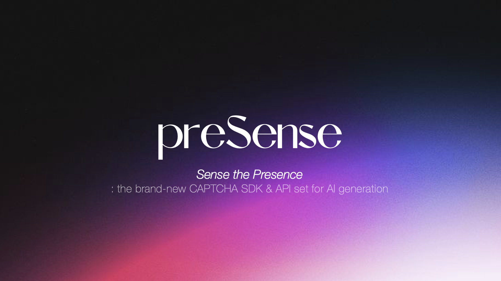

# preSense

> **Sense the Presence** — the brand-new CAPTCHA SDK & API set for AI generation
> c0mpiled-17 · Eunwoo Choi · Byungho Park

화면 너머에 **사람이 물리적으로 있는지**를 묻는 CAPTCHA입니다. "사람처럼 보이는가"가 아니라
"이 기기 앞 공간에 실제로 존재하는가"를 묻습니다 — 잘 만든 생성물은 전자를 통과하지만,
방의 공기와 빛은 통과하지 못합니다.

preSense는 **클라이언트 SDK + 검증 API**입니다. SDK가 사용자 기기에서 챌린지를 실행해
신호를 모으고, 서버가 판정해 서명된 **신뢰 토큰(JWT)** 을 발급합니다. 어떤 앱이든 이 토큰으로
"지금 화면 앞에 실제 사람이 있다"를 확인할 수 있습니다.

---

## 왜 지금인가

- **딥페이크 화상면접을 통한 해외 IT기업 위장취업** — [연합뉴스TV · 2026.05.11](https://www.yonhapnewstv.co.kr/news/MYH20260511064207OYB)
- **HR 전문가 66%가 의심스러운 원격근무 지원 증가를 보고** — [한국경제 · 2026.11.05](https://www.hankyung.com/article/202611057665i)
  <br><sub>Deel × Censuswide · US/UK · n=1,011 · Survey: Nov–Dec 2025</sub>

딥페이크 화상면접은 이미 기업 침투에 쓰이고 있습니다. **그럴듯하게 보이고 들리는 것**만으로는
더 이상 검증이 되지 않습니다.

---

## 검증 레이어

| 체크 | 막는 것 | 상태 |
|---|---|---|
| `sonar` | **사람 부재** — 초음파 에코로 기기 앞의 물리적 움직임을 재고, **음향으로 감지한 입 움직임을 영상 속 입술 움직임과 대조**합니다. 영상 재생·AI 아바타는 화면 속 얼굴만 움직이고 방은 조용합니다 | ✅ |
| `light` | **화면 속 얼굴이 가짜** — 예측 불가능한 빛 패턴을 쏘고, 영상 속 얼굴이 **우리가 실제로 보낸 빛에, 예상된 시각에** 반응했는지 봅니다. 실시간 페이스스왑은 주변만 반응하고 얼굴은 반응하지 않습니다 | ✅ |
| `environment` | 가상 카메라/오디오, 포커스 이탈, 다중 모니터 | ✅ |
| `cover` | **가리기 과제** — 손으로 얼굴을 가렸다 내리는 동안 얼굴·손·경계의 일관성이 유지되는지. 페이스스왑은 이 전이 구간에서 무너집니다 | 🚧 |
| `voice` | 합성 음성(TTS/VC) | 🚧 |

✅ 구현 완료 · 🚧 데모 시나리오에 포함, 코드 미구현 ([상태와 남은 일](#상태와-남은-일))

### 보안 원칙

1. **챌린지는 서버가 매 세션 랜덤 발급** — 빛 펄스의 색과 시각, 초음파 캐리어 주파수, 읽을 문장.
   녹화본은 이번 회차 값을 알 수 없습니다.
2. **판정은 서버에서만** — SDK는 원시 신호만 보냅니다. 조작된 SDK가 "pass"라고 보고해도 의미 없습니다.
3. **어느 하나라도 `fail`이면 거부** — 가중 점수와 별개로 veto.
4. **`inconclusive`는 점수에 섞지 않음** — "못 쟀다"를 "절반쯤 가짜"로 취급하면 미지원 기기가
   멀쩡한 세션을 끌어내립니다. 대신 판정에 도달한 체크의 가중치가 요청한 것의 절반 이상이어야
   통과 — 어려운 체크가 전부 inconclusive일 때 약한 체크 하나로 통과하는 걸 막습니다.

---

## 데모 시나리오

macOS 면접 데모(`apps/login-demo`)에서 preSense SDK가 통화 내내 돌아갑니다.

**① 소나 — 핵심 기여.** 노트북 스피커로 초음파를 쏘고 마이크로 돌아오는 반사를 분석해 기기 앞
물리적 움직임을 찾습니다. 그 다음 **음향으로 감지한 입 움직임을 영상 속 입술 움직임과 대조**합니다.
카메라가 보여주는 것을 물리 측정에 연결하는 단계입니다.
`Physical presence · Acoustic–visual consistency`

**② 가리기 과제 — 대화 중 추가 확인.** 면접관이 질문 도중 과제를 띄우면 참가자가 손으로 얼굴을
가렸다 내립니다. 페이스스왑은 그 움직임 내내 얼굴·손·경계의 일관성을 유지해야 하고, 전이 구간의
불일치를 봅니다. `Cover challenge · Facial consistency`

**③ 빛 검사 — 보낸 자극과 영상의 반응 대조.** 통화 창 테두리의 조명판이 예측 불가능한 패턴으로
깜빡이고, 영상 속 얼굴이 그 빛에 제때 반응했는지 확인합니다. `Light challenge · Response consistency`

**④ 합성 음성 검사.** 대화가 이어지는 동안 답변 음성에서 합성 흔적을 찾습니다.
`Synthetic speech detection`

**⑤ 지속 검증.** 검증은 통화 내내 살아 있습니다. 각 체크의 상태와 마지막 관측 시각이 계속
갱신되고, 면접관은 언제든 새 챌린지를 요청할 수 있으며, 근거가 부족한 구간은 `Inconclusive`로
표시됩니다.

```
preSense SDK  →  Verification API  →  Your application
```

소나–영상 대조는 **로컬에서** 돌아갑니다. 개발자는 데스크톱 앱에 SDK를 넣고 API로 검증 상태를
받아, 추가 확인을 요청하거나 민감한 동작을 보류시킵니다.

**⑥ BEC 대응.** 임원을 사칭한 참가자가 긴급 송금을 요구하는 상황 — 화상회의를 이용한
business email compromise입니다. 의심스러운 결과가 나오면 행동 전에 **독립적인 확인**으로
연결합니다. `Independent confirmation required`
<br><sub>[FBI/IC3 — Business Email Compromise: Virtual Meeting Platforms](https://www.ic3.gov/PSA/2022/PSA220216)</sub>

---

## sonar — 초음파로 존재를 재다

> **무엇을 주장하는가**: "이 기기 앞에 물리적으로 움직이는 몸이 있다."

서버가 세션마다 18–20kHz 캐리어를 뽑아 주고, SDK가 그 톤을 연속 송출하면서 마이크 입력을
AudioWorklet에서 I/Q 복조 → 1kHz 데시메이션 → 6–45Hz 대역통과 → 움직임 에너지로 바꿉니다.
영상에서는 MediaPipe Face Landmarker로 입 벌림(13–14 / 10–152)과 머리 위치를 재고,
`AudioContext.getOutputTimestamp`로 두 시계열을 같은 타임베이스에 올립니다.

- **에코가 정적이면 `fail`** — 화면 속 얼굴은 움직이는데 방은 조용하다는 뜻. 영상 재생·AI 아바타
- 에코가 움직이면 `pass` (0.75). 거기에 **영상 속 입술과의 일치**까지 확인되면 1.0
- 캐리어 SNR이 낮으면 `inconclusive` — 그 기기가 19kHz를 못 내는 것이지 위조 증거가 아님
- 사용자에게 **아무것도 요구하지 않습니다**. 면접 중 오가는 자연스러운 말을 그대로 관찰합니다

> 립 일치는 점수를 올리는 보너스이고, 없다고 떨어뜨리지는 않습니다. CW 단일 톤에서는 머리
> 끄덕임 하나가 입술 신호를 덮어버린다는 걸 실측으로 확인했습니다 —
> 근거와 측정값은 [docs/sonar.md](docs/sonar.md)에 있습니다.

**연구 기반** — 모바일 기기 연구에서 출발했습니다.

- [**SonarGuard · 2023**](https://staff.ustc.edu.cn/~dongheng/dhfiles/2023SonarGuard.pdf) — 초음파와 영상의 입술 움직임 대조
- [**SonarGuard2 · Interspeech 2025**](https://www.isca-archive.org/interspeech_2025/zhang25f_interspeech.pdf) — 얼굴 전후 움직임을 이용한 모바일 초음파 라이브니스

노트북별 송수신 확인은 meet 앱의 **Sonar Lab**에서 합니다 (주파수 스윕, 실시간 그래프,
캐리어 도달·톤 순도).

📄 **설계 근거·실측·틀렸던 가정 → [docs/sonar.md](docs/sonar.md)**

---

## light — 보낸 빛이 얼굴에서 돌아오는가

> **무엇을 주장하는가**: "화면에 보이는 얼굴은 지금 이 화면이 비추고 있는 물리적 표면이다."
> 신원은 **주장하지 않습니다** — 실제 표면인지까지만 말합니다.

통화 창 **가장자리를 따라 조명판**(상·하·좌·우 4개 스트립)을 달고, 서버가 세션마다 뽑은
색·시각으로 간헐적으로 빛을 쏩니다. 통화 화면은 가리지 않습니다 — 전체 화면 플래시는 면접
중에 쓸 수 없고, 테두리는 그 타협입니다. 펄스 사이에는 **검정으로 켜두어** 기준선을 고정합니다.

SDK는 MediaPipe 랜드마크로 같은 프레임에서 두 영역을 잽니다: **얼굴 피부**(이마 + 양 볼)와
**얼굴 바로 바깥 띠**(벽·머리카락·어깨). 서버는 둘 다 **색도**(채널/합)로 바꿔 펄스 스케줄과
상관시킵니다 — 비율은 램프·노출 이득·콘텐츠 밝기 변화에 불변이라, "이 화면이 비췄는가"와
"그냥 밝아졌는가"가 갈립니다.

- 얼굴과 주변이 **함께** 따라가면 `pass` 1.0
- 얼굴만 따라가면 `pass` 0.85 (뒤쪽 벽이 멀어 반응이 없는 흔한 경우)
- **주변은 따라가는데 얼굴만 반응 없으면 `fail`** — 얼굴이 렌더되고 있다는 뜻. `sonar`가
  구조적으로 못 보는 실시간 페이스스왑이 여기서 걸립니다
- 밝기는 변하는데 조명판의 **색**이 아니면 `fail` — 자체 점멸이 있는 재생 영상
- 과노출·주변광 압도·느린 랜드마커는 `inconclusive` — 기기 한계는 위조 증거가 아님
- 점멸은 약 1Hz, 화면 면적의 약 1/4 — WCAG 2.3.1의 3Hz 기준 아래

첫 실측(MacBook 내장캠): 얼굴 상관 **0.88** vs 우연 0.05, 응답 깊이 **2.96%**, 6/6 펄스.

노트북·방별 반사량 확인은 meet 앱의 **Light Lab**에서 합니다 (펄스별 깊이, 노출 보정 감쇠,
포화 비율, 영상 클록).

📄 **설계 근거·틀렸던 가정·남은 일 → [docs/light.md](docs/light.md)**

---

## 구조

```
packages/
  shared/   공통 스키마 (zod): 챌린지, 증거, 판정, API 계약
  sdk/      클라이언트 SDK: 챌린지 실행 + 신호 수집 (판정은 하지 않음)
  server/   검증 API (Hono): 챌린지 발급, 판정, 토큰 서명
apps/
  login-demo/  macOS 면접 데모 (Electron) — 제출 데모
  meet/        브라우저 데모 + Sonar Lab / Light Lab (하드웨어 점검)
```

> 패키지·식별자 이름은 아직 `@knock/*`입니다. 리브랜딩 전 내부 이름이고, 데모 동작과는
> 무관합니다.

## API

| Method | Path | 설명 |
|---|---|---|
| `POST` | `/v1/sessions` | `{ checks }` → 세션 + 챌린지 발급 |
| `POST` | `/v1/sessions/:id/evidence` | `{ evidence }` → 해당 체크 판정 |
| `POST` | `/v1/sessions/:id/verify` | 최종 판정 + 신뢰 토큰 |
| `POST` | `/v1/tokens/introspect` | 연동 앱 백엔드용 토큰 검증 |

## SDK 사용 예

```ts
import { createKnock } from '@knock/sdk'

const preSense = createKnock({ apiUrl: 'http://localhost:8787' })
preSense.watchEnvironment()

const { verdict, token } = await preSense.verify(['environment', 'light', 'sonar'], {
  stream,
  video,
  onResult: (r) => console.log(r),
  // 사용자에게 보여줄 지시. light는 "얼굴을 화면에 보이게", voice는 읽을 문장.
  // sonar는 아무것도 요구하지 않습니다.
  onPrompt: (prompt) => setPrompt(prompt),
  // light의 테두리 조명판을 걸 곳. 기본값은 창 전체 (데스크톱 셸에서는 앱 프레임).
  panelHost: callFrameRef.current ?? undefined,
  // 마이크 거부처럼 한 체크가 실패해도 나머지는 계속 진행됩니다.
  onCheckError: (kind, err) => console.warn(kind, err),
  signal: controller.signal,
})
// token을 자기 백엔드로 보내 /v1/tokens/introspect로 검증
```

## 시작하기

```bash
cp .env.example .env
npm install

npm run dev            # server(:8787) + meet(:5173) — 브라우저 데모 + Lab
npm run dev:desktop    # server(:8787) + login-demo (Electron) — 제출 데모

npm run typecheck
npm test
```

> Chrome 권장. Safari는 `requestVideoFrameCallback`이 없어 sonar가 `inconclusive`가 됩니다.
> sonar는 **스피커로 소리가 나야** 합니다 — 이어폰을 꽂으면 스피커→방→마이크 경로가 사라집니다.

---

## 상태와 남은 일

**구현 완료** — `sonar`, `light`, `environment`. 서버 판정 → 신뢰 토큰 발급 → introspect까지
end-to-end로 동작합니다. 서버 검증기 테스트 18개, 데모 앱 테스트 24개.

**미구현** — 데모 시나리오에는 들어가지만 코드에는 아직 없습니다.

- [ ] `cover`: 가리기 과제 — 얼굴·손·경계 일관성 판정
- [ ] `voice`: AASIST/RawNet2 사이드카 (지금은 SDK가 빈 오디오를 보내고 서버 검증기도 비어 있음)

**다음**

- [ ] **임계값 확정 (최우선)** — sonar의 `echo variation`, light의 `MIN_DEPTH`. 둘 다
      시뮬레이션 기반 잠정값입니다 → [docs/sonar.md](docs/sonar.md#7-남은-일),
      [docs/light.md](docs/light.md#6-임계값--전부-잠정값)
- [ ] light: 목 영역을 세 번째 ROI로 (피부라 깊이가 비교 가능, 얼굴 전용 모델은 안 건드림)
- [ ] light: 스트립을 따로 켜서 얼굴 좌/우 음영 기울기 비교 (모델이 재현하기 더 어려움)
- [ ] meet: WebRTC 통화 연결, 초음파 성분 송출 오디오에서 필터링
- [ ] 공격 데모 시나리오: OBS 가상캠 → 영상 재생 → 실시간 페이스스왑

---

**preSense** · *Sense the Presence.*
`SDK + API · Continuous verification`
